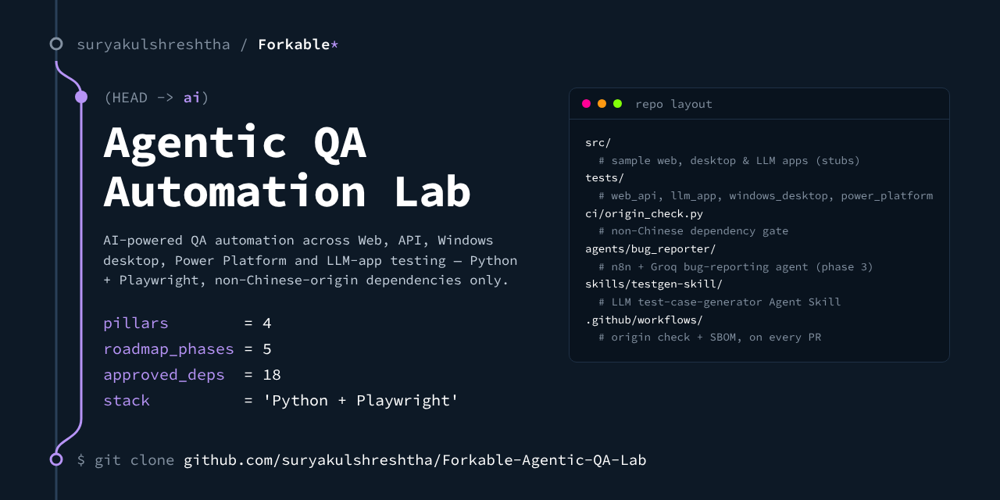
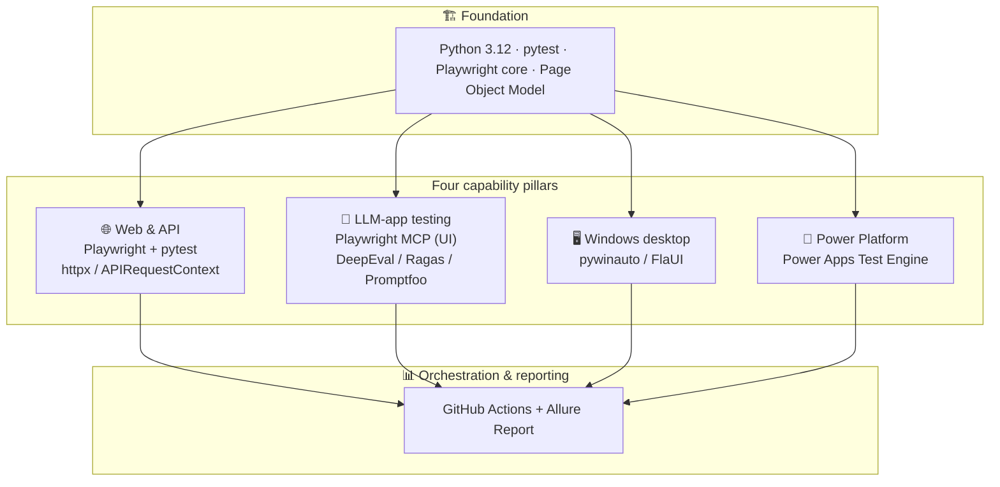
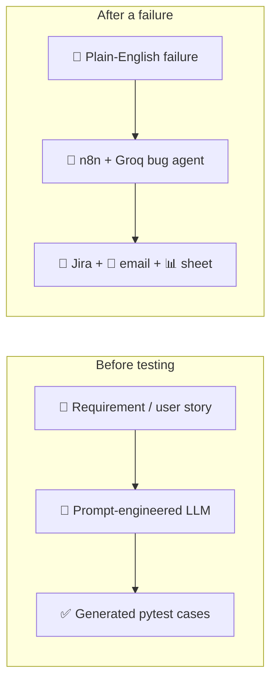

<!-- forkable-card:start (added by apply_cards.py; re-run it to update) -->

<!-- forkable-card:end -->

<div align="center">

# 🤖 Forkable Agentic QA Lab

### AI-powered, Python + Playwright test automation — across Web, API, Desktop, Power Platform & LLM apps

[](https://www.python.org/)
[](https://playwright.dev/python/)
[](https://docs.pytest.org/)
[](./LICENSE)
[](./THIRD_PARTY_ORIGINS.md)
[](#-roadmap)

**One pytest entry point. Five surfaces. An AI-agent layer around it.**

</div>

---

## 📑 Table of contents

- [🧭 What this is](#-what-this-is)
- [🧩 Architecture](#-architecture)
- [📊 Capability matrix](#-capability-matrix)
- [🛠️ Tech stack](#️-tech-stack)
- [💻 Environment setup (beginner-friendly)](#-environment-setup-beginner-friendly)
- [📁 Repository structure](#-repository-structure)
- [🗺️ Roadmap](#️-roadmap)
- [🤖 The AI-agent layer](#-the-ai-agent-layer)
- [🔒 Non-Chinese dependency policy](#-non-chinese-dependency-policy)
- [📚 Official references](#-official-references)
- [🤝 Contributing](#-contributing)
- [📄 License](#-license)

---

## 🧭 What this is

A public, hands-on showcase of **AI-powered test automation** built around **Python** and **Playwright** as the base, demonstrating:

- 🌐 **Web UI testing** — Playwright (Python), Page Object Model
- 🔌 **API testing** — `httpx` / Playwright `APIRequestContext` + pytest
- 🖥️ **Windows desktop testing** — pywinauto / FlaUI
- 🔷 **Power Apps & Power Automate testing** — Microsoft's official Power Apps Test Engine
- 🧠 **LLM-application testing** — Playwright MCP for the UI layer + DeepEval / Ragas / Promptfoo for prompt-and-output evaluation
- 🪄 **An AI-agent layer** — LLM-driven test-case generation and an n8n + Groq defect-reporting agent, wrapped around the core

Every third-party tool in this repo has been **origin-checked** against a non-Chinese-dependency policy — see [`THIRD_PARTY_ORIGINS.md`](./THIRD_PARTY_ORIGINS.md) for the full ledger and reasoning.

> 🚧 **Status:** this repo is being built in public, phase by phase — see the [Roadmap](#️-roadmap). Folders that aren't filled in yet contain a short `README.md` explaining what's coming.

---

## 🧩 Architecture



See [`docs/architecture.md`](./docs/architecture.md) for the full write-up, including the AI-agent layer that wraps around this core.

---

## 📊 Capability matrix

| Surface | Feasibility | Primary tooling | Effort | Risk |
|---|:---:|---|:---:|:---:|
| 🌐 Web UI | ✅ High | Playwright (Python) + pytest | 🟢 S | 🟢 Low |
| 🔌 API | ✅ High | `httpx` / `APIRequestContext` + pytest | 🟢 S | 🟢 Low |
| 🧠 LLM-app testing | ✅ High (differentiator) | Playwright MCP + DeepEval / Ragas / Promptfoo | 🟡 M | 🟡 Medium |
| 🖥️ Windows desktop | 🟡 Medium | pywinauto / FlaUI | 🟡 M | 🟡 Medium |
| 🔷 Power Apps | 🟡 Medium | Power Apps Test Engine (Microsoft) | 🟠 M–L | 🟠 Medium-High |
| 🔁 Power Automate | 🟠 Low–Medium | API-boundary tests + pywinauto (desktop flows) | 🟡 M | 🟠 Medium-High |
| 🔒 Dependency governance | ✅ High | `pip-audit` + `cyclonedx-py` + origin gate | 🟢 S | 🟢 Low |

---

## 🛠️ Tech stack

| Layer | Tool | Publisher / origin | License |
|---|---|---|---|
| 🐍 Language & runner | Python 3.12, pytest | Python Software Foundation (US) | PSF / MIT |
| 🌐 Browser automation | [Playwright (Python)](https://playwright.dev/python/) | Microsoft (US) | Apache-2.0 |
| 🤝 Agentic browser control | [Playwright MCP](https://github.com/microsoft/playwright-mcp) | Microsoft (US) | Apache-2.0 |
| 🖥️ Windows desktop automation | [pywinauto](https://pywinauto.readthedocs.io/) | Open community (BSD-3) | BSD-3-Clause |
| 🔷 Power Platform testing | [Power Apps Test Engine](https://github.com/microsoft/PowerApps-TestEngine) | Microsoft (US) | MIT |
| 🧠 LLM evaluation | [DeepEval](https://deepeval.com/) · [Ragas](https://ragas.io/) · [Promptfoo](https://www.promptfoo.dev/) | Confident AI · Exploding Gradients · Promptfoo Inc. (all US) | Apache-2.0 / MIT |
| 📊 Test reporting | [Allure Report](https://allurereport.org/) | Qameta Software (US/Estonia) | Apache-2.0 |
| ⚙️ CI/CD | [GitHub Actions](https://docs.github.com/actions) | Microsoft/GitHub (US) | — |
| 🔗 Agent orchestration | [n8n](https://docs.n8n.io/) | n8n GmbH (Berlin, Germany) | Sustainable Use ("fair-code") |
| ⚡ LLM inference | [Groq](https://console.groq.com/docs) | Groq, Inc. (Mountain View, US) | — |

> ℹ️ **Groq ≠ Grok.** Groq is the US inference-chip/cloud company used here; Grok is xAI's separate model. Easy to mix up — called out explicitly so this README stays accurate.

---

## 💻 Environment setup (beginner-friendly)

Follow these in order. Each step says **why**, not just what, so it's clear what you'd be undoing if something goes wrong.

### Step 1 — Install Python 3.12+

| Platform | Command |
|---|---|
| 🪟 **Windows** (PowerShell) | `winget install Python.Python.3.12` |
| 🍎 **macOS** (Terminal, with [Homebrew](https://brew.sh/)) | `brew install python@3.12` |

Check it worked (same command, both platforms):

```bash
python3 --version
```

### Step 2 — Install `uv` (fast Python package/dependency manager)

| Platform | Command |
|---|---|
| 🪟 **Windows** (PowerShell) | `powershell -ExecutionPolicy ByPass -c "irm https://astral.sh/uv/install.ps1 \| iex"` |
| 🍎 **macOS** (Terminal) | `curl -LsSf https://astral.sh/uv/install.sh \| sh` |

### Step 3 — Clone the repo and install dependencies

| Platform | Command |
|---|---|
| 🪟 **Windows** (PowerShell) | `git clone https://github.com/suryakulshreshtha/Forkable-Agentic-QA-Lab.git; cd Forkable-Agentic-QA-Lab; uv sync` |
| 🍎 **macOS** (Terminal) | `git clone https://github.com/suryakulshreshtha/Forkable-Agentic-QA-Lab.git && cd Forkable-Agentic-QA-Lab && uv sync` |

### Step 4 — Install Playwright's browsers

Same command on both platforms, run from inside the repo folder:

```bash
uv run playwright install
```

### Step 5 — Copy the environment template and fill in secrets

| Platform | Command |
|---|---|
| 🪟 **Windows** (PowerShell) | `copy .env.example .env` |
| 🍎 **macOS** (Terminal) | `cp .env.example .env` |

Then open `.env` in any text editor and fill in the values described inline (API keys, tenant IDs — never commit this file; it's already in `.gitignore`).

### Step 6 — Run the test suite (once Phase 1 lands)

```bash
uv run pytest
```

### Windows-only — desktop testing prerequisite

Desktop tests (`tests/windows_desktop/`) need [pywinauto](https://pywinauto.readthedocs.io/), which only drives Windows UI Automation, so that suite only runs on a Windows machine or a `windows-latest` GitHub Actions runner — it's skipped automatically on macOS/Linux.

---

## 📁 Repository structure

```text
Forkable-Agentic-QA-Lab/
├─ README.md
├─ LICENSE
├─ THIRD_PARTY_ORIGINS.md
├─ CONTRIBUTING.md
├─ .gitignore
├─ .env.example
├─ pyproject.toml
│
├─ .github/workflows/        — CI pipelines (origin/SBOM gate is live; test workflows activate per phase)
├─ src/                      — sample apps under test + the test-case generator
│  ├─ sample_web_app/
│  ├─ sample_desktop_app/
│  ├─ sample_llm_app/
│  └─ testgen/
├─ tests/                    — the five test pillars
│  ├─ web_api/
│  ├─ llm_app/
│  ├─ windows_desktop/
│  ├─ power_platform/
│  └─ generated/
├─ agents/bug_reporter/      — the n8n + Groq defect-reporting agent
├─ skills/testgen-skill/     — Agent Skill wrapping the test-case generator
├─ ci/                       — origin_check.py (dependency-origin CI gate) + SBOM output
├─ reports/                  — Allure output (git-ignored, published as a CI artifact)
├─ docs/                     — architecture, policy and philosophy write-ups
└─ scripts/                  — setup + repo-metadata scripts
```

---

## 🗺️ Roadmap

| Phase | Weeks | Focus | Status |
|---|:---:|---|:---:|
| 1️⃣ | 1–2 | Foundation: repo, CI, origin gate | 🟡 In progress |
| 2️⃣ | 3–4 | Web & API suite | ⬜ Planned |
| 3️⃣ | 5–7 | LLM-app testing (the differentiator) | ⬜ Planned |
| 4️⃣ | 8–9 | Windows desktop suite | ⬜ Planned |
| 5️⃣ | 10–12 | Power Platform (Power Apps Test Engine) | ⬜ Planned |

Hardening (CI polish, SBOM, Allure history) runs continuously alongside every phase, not as a separate one.

---

## 🤖 The AI-agent layer

Two optional flows sit **around** the core above — neither replaces pytest/Playwright, both can be demoed independently:



- **Test-case generator** (`src/testgen/`) — exposed both as an **MCP server** (so Claude Code / Copilot can call it mid-session) and as an **Agent Skill** (`skills/testgen-skill/SKILL.md`) for anyone working in the repo without an MCP client.
- **Bug-reporting agent** (`agents/bug_reporter/`) — an [n8n](https://docs.n8n.io/) workflow, triggered by a failing CI run, that uses [Groq](https://console.groq.com/docs) for fast LLM inference to extract defect details and file them to Jira, email, and a tracking sheet.

Full rationale: [`docs/ai_qa_philosophy.md`](./docs/ai_qa_philosophy.md).

---

## 🔒 Non-Chinese dependency policy

Every dependency added to this repo is checked for its **controlling publisher**, not just its license, before it's added — see [`THIRD_PARTY_ORIGINS.md`](./THIRD_PARTY_ORIGINS.md) for the method, the ledger, and the CI gate (`ci/origin_check.py`) that enforces it automatically on every pull request.

---

## 📚 Official references

Every tool above links to its own official documentation in the tables; the primary ones, gathered here for convenience:

- [Playwright for Python — official docs](https://playwright.dev/python/)
- [Playwright MCP — GitHub (Microsoft)](https://github.com/microsoft/playwright-mcp)
- [pywinauto — official docs](https://pywinauto.readthedocs.io/)
- [Power Apps Test Engine — Microsoft Learn](https://learn.microsoft.com/power-platform/test-engine/overview)
- [DeepEval — official docs](https://deepeval.com/docs/getting-started)
- [Ragas — official docs](https://docs.ragas.io/)
- [Promptfoo — official docs](https://www.promptfoo.dev/docs/intro/)
- [Allure Report — official docs](https://allurereport.org/docs/)
- [GitHub Actions — official docs](https://docs.github.com/actions)
- [n8n — official docs](https://docs.n8n.io/)
- [Groq — official API docs](https://console.groq.com/docs)
- [Model Context Protocol — official docs](https://modelcontextprotocol.io/)
- [CycloneDX Python (SBOM) — official docs](https://cyclonedx-python.readthedocs.io/)
- [pip-audit — PyPA project](https://pypi.org/project/pip-audit/)

---

## 🤝 Contributing

See [`CONTRIBUTING.md`](./CONTRIBUTING.md). Issues and PRs are welcome once Phase 1 lands.

## 📄 License

[MIT](./LICENSE) — see the file for the full text.

---

<div align="center">

Built as a public, phase-by-phase showcase of AI-powered QA engineering. ⭐ Star the repo to follow along.

</div>
