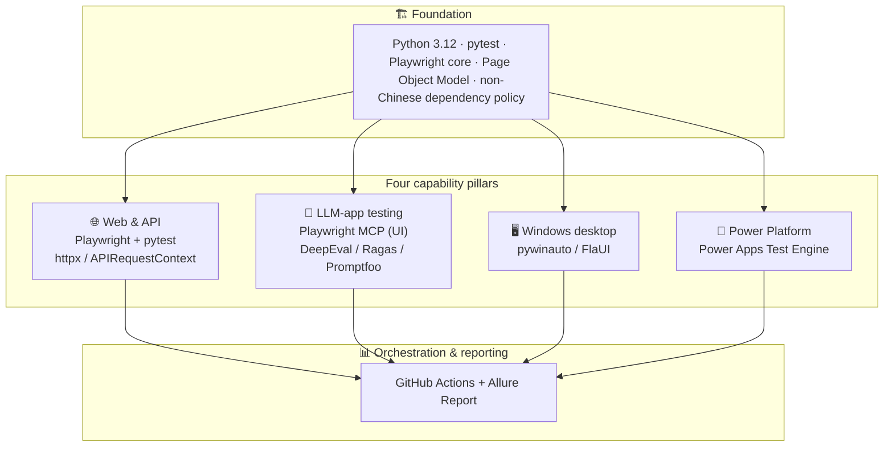
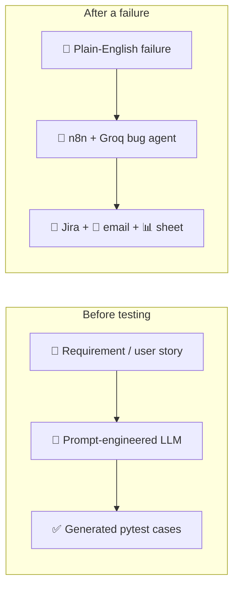

# 🧩 Architecture

## The core: one pytest entry point, four pillars, one foundation

A new surface is added as a new pillar on the same foundation — it is never a parallel framework with its own
test runner, config system, or CI job pattern.

## The AI-agent layer: two optional flows around the core

- **"Before testing"** feeds hand-written-quality pytest cases into the same suite the core runs — it is a
  productivity multiplier on authoring, not a different kind of test.
- **"After a failure"** only fires once pytest/Playwright has already found something; it automates the
  reporting chore, not the detection.

Neither lane replaces the Playwright core, and both can be built, demoed, or skipped independently of it.

## Why Microsoft's Power Apps Test Engine, not raw Playwright, for Power Apps

Canvas apps render through a heavily virtualized, non-semantic runtime, so hand-rolled Playwright selectors
break on every studio republish. [Power Apps Test Engine](https://github.com/microsoft/PowerApps-TestEngine)
is Microsoft's own open-source project, **built on top of Playwright**, specifically to give canvas and
model-driven apps a stable automation surface with Power Fx–based test authoring. Using it is the sanctioned
path, not a workaround.

## Why a companion library for Windows desktop

Playwright automates browser engines (Chromium/Firefox/WebKit) and Electron through the Chrome DevTools
Protocol; it has no driver for native Win32 / UI Automation. Desktop coverage needs
[pywinauto](https://pywinauto.readthedocs.io/) (Python-native, UI Automation + Win32 backends) or
[FlaUI](https://github.com/FlaUI/FlaUI) (.NET) alongside Playwright — the repo still presents one unified
`pytest` entry point across both.
